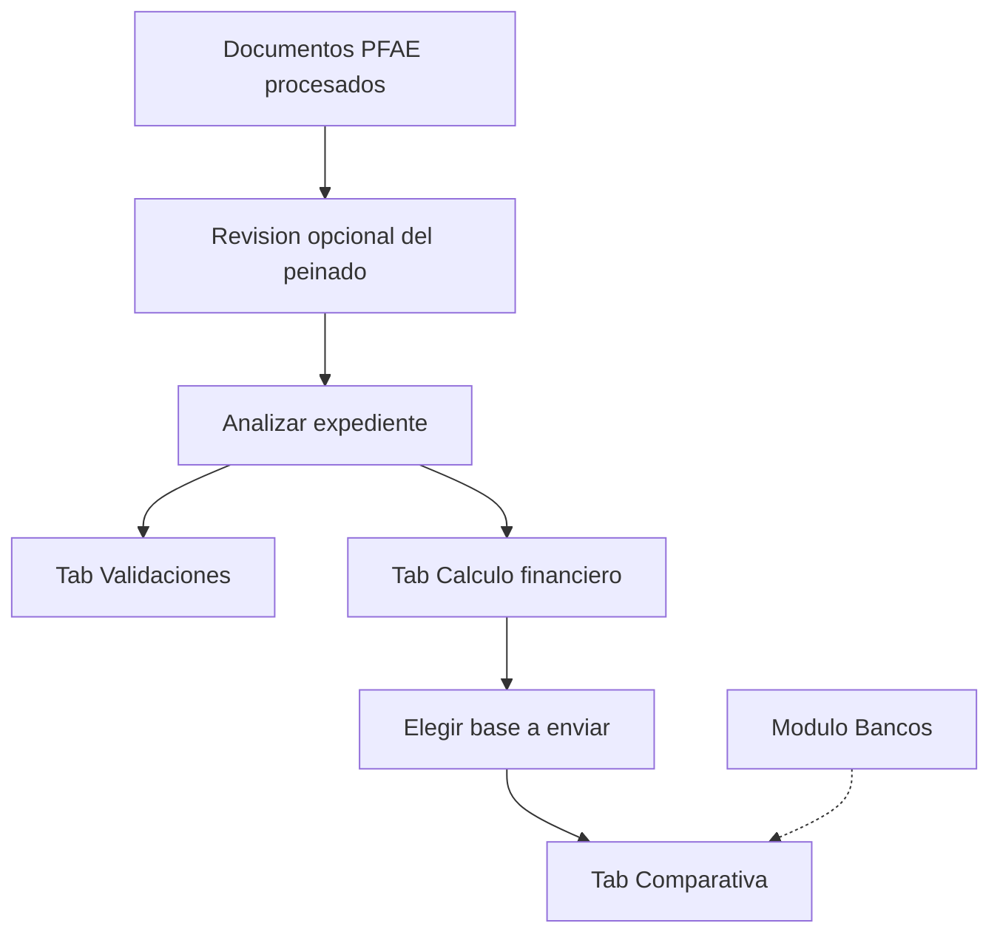
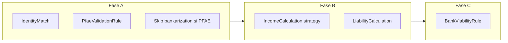

# Fase de validación PFAE — flujo y arquitectura

Documento de fase (pre-SDD). Cierra el flujo de usuario, las ramificaciones del
pipeline A/B/C, la extensión del módulo Bancos y el corte en HUs. Cada HU sigue
su propio ciclo SDD. El perfil asalariado no cambia.

Fuente de alcance original: [PLAN-PERFIL-PFAE.md](PLAN-PERFIL-PFAE.md) fases C–F
(HU-18 … HU-21). Este documento **manda** cuando hay conflicto con decisiones
anteriores de entrevista (giro capturado a mano).

Rama base: `feature/perfil-pfae`.

---

## Quick path

1. La asesora procesa documentos PFAE (ya existe).
2. Opcional: revisa el peinado de depósitos (no bloquea).
3. Pulsa **Analizar expediente** (el mismo botón de hoy).
4. Revisa **Validaciones** (identidad con CSF + gates PFAE).
5. Revisa **Cálculo financiero** (pasivos + dos bases de ingreso) y elige cuál se envía.
6. Lee **Comparativa bancaria** (ingreso admisible por banco × CE − deuda).
7. CMA y factores se editan en `/dashboard/bancos`. El CMA no se duplica por perfil; el arraigo sí tiene umbral distinto.

---

## Decisiones cerradas

| Tema | Decisión |
|------|----------|
| Cáscara de UI | Las 3 pestañas actuales. No hay wizard ni pestaña nueva. |
| Trigger | Un `POST /analyze`. Giro y antigüedad salen de la CSF; no hay paso previo. |
| Giro | Automático desde CSF `activities[]`. La asesora no elige ni confirma. |
| Varias actividades CSF | Activa (`endDate` null) con **mayor porcentaje**. Empate: menor `order`. Sin porcentaje: primera activa por `order`. |
| Mapeo SAT → banco | Catálogo canónico `ActivityType` + alias SAT. Factor por banco en `BankActivityFactor`. Sin match: warning + `REQUIRES_REVIEW` en bancos de matriz. Banorte sigue flat; HSBC factor 1.0. |
| 6 vs 12 meses | Flag `requiresTwelveMonths` en `ActivityType` (primarias / restaurantero). Default 6 meses. |
| Bases de ingreso | El análisis calcula **ambas**. Default a enviar: estados de cuenta si hay base válida; si no, declaración. |
| Elegir base | Después del análisis, en Cálculo. Recalcula **solo Fase C** (no re-extrae). |
| Pérdida fiscal | Knockout **solo** del camino declaración. El expediente sigue por estados de cuenta. |
| Identidad | PFAE: INE, CSF, **declaración anual (nombre + RFC)**, estados, buró, cliente. Nómina fuera. Misma normalización determinística. |
| Bankarization | No corre en PFAE. La pestaña Validaciones no muestra conciliación nómina↔banco. |
| Pasivos revolventes | PFAE: `MAX(saldo × 0.07, pago)`. Asalariado: 0.06 intacto. |
| Arraigo | El único CMA que **cambia por perfil**. Asalariado: antigüedad laboral. PFAE: meses desde `activityStartDate` CSF. Cada uno tiene su umbral por banco (y por destino si el PDF lo distingue). |
| Vigencia CSF | Warning si emisión > 3 meses. No descarta. |
| Régimen | Solo sueldos y salarios → FAIL de camino PFAE (alerta de cambiar a asalariado). |
| CMA (ingreso, inmueble, edad, destinos, CE, NET/GROSS, score) | **Iguales para asalariado y PFAE.** No se duplica la grilla por perfil. |
| Módulo Bancos — qué se agrega | (1) columna de antigüedad PFAE junto a la asalariada; (2) tabla de factores por giro, cuando lleguen los datos. Nada más. |
| Factores por giro | Los tiene la asesora; se cargan al empezar el módulo Bancos. No bloquean identidad ni el motor. |
| CE / NET-GROSS | No se recalibran. Mifel CE seed **0.42** (Excel manda). |
| Factor salud Mifel 1.5 | Se siembra como está en el Excel; editable en Bancos. Confirmar con asesora en HU-20 si es typo. |
| Condicionado vs rechazado | Se reutilizan PASS/PARTIAL/FAIL y PRELIMINARY_VIABLE / CONDITIONED / REQUIRES_REVIEW / NOT_COMPATIBLE. |

---

## 1. Flujo de usuario

### 1.1 Happy path



La revisión de peinado vive en **extracción** (ya existe). No es un paso del análisis.

### 1.2 Tab Validaciones (PFAE)

Reemplaza el contenido asalariado, no el tab.

**Identidad.** Matriz `fullName` / `rfc` / `curp` con fuentes:

- INE (`official-id`)
- CSF (`csf` ← `taxpayer`)
- Declaración anual (`tax-return` ← `satReceipt.taxpayerName` + `satReceipt.rfc`). Sin CURP en el acuse → `NOT_AVAILABLE` en esa celda.
- Estado de cuenta (`bank-statement` ← `accountHolder`)
- Buró (`credit-bureau`)
- Cliente del expediente (`client`)

RFC o CURP mismatch entre documentos → FAIL. Solo nombre → PARTIAL. Cliente es referencia operativa (mismatch → WARNING, no FAIL legal). La declaración es fuente de primera: mismo criterio que estados de cuenta (nombre + RFC).

**Gates PFAE** (nueva sección bajo identidad; sustituye “Conciliación nómina vs banco”):

| Regla | Outcome | Dónde se ve |
|-------|---------|-------------|
| Régimen exclusivamente sueldos y salarios | FAIL camino PFAE | Validaciones |
| Arraigo vs umbral del banco | Se evalúa en comparativa (columna PFAE del CMA). Validaciones solo muestra meses de CSF. | Comparativa |
| CSF vigencia > 3 meses | WARNING | Validaciones |
| Actividad CSF no mapeada al catálogo | WARNING | Validaciones |
| Coherencia actividad ↔ depósitos (p. ej. rentas sin régimen de arrendamiento) | WARNING o FAIL según regla existente del cleaner | Validaciones |

El modal pre-análisis, hoy payroll-céntrico, en PFAE pide: INE/pasaporte, CSF, declaración, estados, buró. Faltantes = confirmación suave, no bloqueo (igual que asalariado).

### 1.3 Tab Cálculo financiero

Orden: pasivos (buró) → ingresos PFAE.

**Pasivos.** Misma UI. Cambia el factor revolvente a 7% en PFAE.

**Ingresos.** Deja de ser promedio de nóminas. Muestra:

1. Base estados de cuenta: meses cubiertos, mes alto/bajo excluidos, promedio suavizado, desglose auditable (enlace al peinado).
2. Base declaración: utilidad/12 (NETO) o acumulables/12 (BRUTO), ejercicio, flag de pérdida fiscal.
3. Control **“Base a enviar al banco”** (una sola). Default: estados si la base es válida; si no, declaración. Pérdida fiscal deshabilita declaración y fuerza estados.

Cambiar la base dispara recálculo de comparativa (Fase C) sin volver a extraer.

### 1.4 Tab Comparativa bancaria

Misma tabla. Columnas/razones nuevas en el detalle por banco:

- Origen de ingreso (`BANK_STATEMENTS` | `TAX_RETURN`)
- Giro canónico + texto SAT de origen
- Factor aplicado (o “sin factor” HSBC / flat Banorte)
- `ingresoAdmisible` → `máximo = × CE` → `capacidad = − deuda`
- `taxReturnPolicy`: si la base es declaración y el banco es `REJECTED` (Scotiabank) → NOT_COMPATIBLE; `NOT_PREFERRED` (Banorte) → CONDITIONED

Antigüedad: asalariado sigue leyendo nóminas vs columna asalariada; PFAE usa `activityStartDate` CSF vs columna PFAE. El resto del CMA (ingreso, inmueble, edad, destino activo) es el mismo.

### 1.5 Módulo Bancos — tres capas, no tres dimensiones

No se copia la política por perfil. El detalle de un banco tiene **tres capas**:

1. **Tarjeta del banco** (ya existe): CE, NET/GROSS, score mínimo, activo. Igual para ambos perfiles.
2. **Grilla CMA por destino** (ya existe): una fila por objetivo de crédito. Columnas compartidas: ingreso mín., valor inmueble, edad mín./máx., activo. **Único extra por perfil:** partir antigüedad en dos columnas (`Antigüedad asalariado` | `Antigüedad PFAE`). Si el PDF da el mismo número en todos los destinos, se copia; no hace falta otra pantalla.
3. **Tabla factores por giro** (nueva, cuando lleguen los datos): banco × actividad. Solo PFAE. No se mezcla con el CMA.

Por qué no duplicar la grilla por perfil: 9 bancos × 6 destinos × 2 perfiles = 108 filas para cambiar un ingreso mínimo que es el mismo. Con dos columnas de arraigo: 54 filas, como hoy, más una tabla aparte de factores.

`taxReturnPolicy` (Santander acepta declaración, Scotiabank no) no es CMA: si se agrega, va en la **tarjeta del banco**, no en la grilla. Se puede dejar para HU-20.

### 1.6 Bordes (misma cáscara)

| Situación | Qué ve la asesora |
|-----------|-------------------|
| Sin CSF procesada | Identidad sin fuente fiscal; gates PFAE PARTIAL; giro unmatched; comparativa con `REQUIRES_REVIEW` en bancos MATRIX |
| CSF con varias actividades | Se usa la de mayor %; el resto queda en el detalle auditable |
| Sin estados / solo declaración | Una base; default declaración; Scotiabank NOT_COMPATIBLE si se envía declaración |
| Pérdida fiscal | Declaración deshabilitada; alerta “cambie a estados de cuenta” |
| Peinado con discrepancias críticas | Warning en Cálculo; el análisis no se bloquea |
| Régimen solo sueldos | FAIL en Validaciones; comparativa no se presenta como viable PFAE |
| Asalariado | Cero cambios de flujo |

---

## 2. Arquitectura del pipeline

Principio: `personType` es el único discriminador. No hay segundo orquestador.



Orquestador: [`apps/api/src/case-analysis/case-analysis.service.ts`](apps/api/src/case-analysis/case-analysis.service.ts).

### 2.1 Fase A — Validaciones

**IdentityMatch** ([`identity-match.rule.ts`](apps/api/src/case-analysis/rules/identity-match.rule.ts)):

- Si `SALARIED`: fuentes actuales (incluye `payroll`).
- Si `PFAE`: fuentes `csf` (`taxpayer.fullName/rfc/curp`) y `tax-return` (`satReceipt.taxpayerName` + `satReceipt.rfc`; CURP ausente → `NOT_AVAILABLE`); omitir `payroll` aunque existiera un doc suelto. RFC mismatch en declaración → FAIL, igual que el resto de documentos.
- Normalización y severidad: sin cambios ([`openspec/specs/identity-match-validation/spec.md`](openspec/specs/identity-match-validation/spec.md)).

**Nueva `PfaeValidationRule`** (`ruleId: pfae-validation`), solo si `personType === PFAE'`:

- Consume `extractedData` + `alerts` de CSF y declaración (HU-16 ya los persiste en el documento; Fase A los **eleva** a `AnalysisRun`).
- Produce `detail.fields[]` / `alerts[]` tipados para la UI de gates.
- Régimen exclusivo asalariado → FAIL. El resto de gates no detiene B/C (mismo contrato actual: Fase A no bloquea B/C).

**BankarizationValidationRule**: no se registra / early-return PASS vacío en PFAE.

Resolver de giro (puro, determinístico, compartido con B y C):

```
resolveCanonicalActivity(csf.activities) →
  { satDescription, activityTypeId | null, requiresTwelveMonths }
```

Vive en un helper de dominio (no en Gemini). El cleaner de estados ya usa `economicActivities[]` para sector; no se duplica esa heurística: el catálogo canónico es la fuente de 6/12 y de factores.

### 2.2 Fase B — Motor financiero

**Ingreso** ([`income-calculation.service.ts`](apps/api/src/income-calculation/income-calculation.service.ts)):

| `personType` | Estrategia |
|--------------|------------|
| SALARIED | Actual: promedio de `PAYROLL_RECEIPT`. |
| PFAE | Dual: estados depurados + declaración. |

Extender `IncomeCalculation` (mismo modelo, sin tabla paralela):

- `source`: `PAYROLL | BANK_STATEMENTS | TAX_RETURN` — la base **elegida** para Fase C.
- `bases`: JSONB con ambas bases PFAE, meses usados, mes alto/bajo, flags (`hasTaxLoss`, `coverageMonths`, `activityResolution`).
- `averageGrossIncome` / `averageNetIncome`: la base elegida proyectada a bruto/neto según `incomeCriterion` de cada banco se resuelve en C; el snapshot guarda las dos cifras canónicas de la base elegida (estados = un número suavizado usado como ambos si el banco pide NET o GROSS sobre la misma base de estados; declaración = utilidad vs acumulables).

Promedio suavizado (siempre):

- 6 meses → excluir max y min, promedio de 4.
- 12 meses → excluir max y min, promedio de 10.
- Meses = depósitos **válidos** post-peinado, agrupados por periodo del estado.

Declaración:

- NETO: `utilidadFiscal / 12`
- BRUTO: `ingresosAcumulables / 12`
- `hasTaxLoss` → base declaración `invalid`, no se puede elegir.

**Pasivos** ([`liability.service.ts`](apps/api/src/liability/liability.service.ts)):

- Factor default hoy `0.06`. Si `personType === PFAE`, `0.07`.
- Fórmula: `MAX(saldo × factor, pago)` en centavos. Resto del clasificador revolvente/fijo intacto.

### 2.3 Fase C — Comparativa

[`bank-viability.rule.ts`](apps/api/src/case-analysis/rules/bank-viability.rule.ts) ramifica por `personType` **solo** en origen de ingreso, factor de giro, `taxReturnPolicy` y fecha de antigüedad (CSF). Knockouts de buró, CMA de destino, CE y NET/GROSS se reutilizan.

Por banco activo con política del destino del caso:

1. Tomar base elegida (`IncomeCalculation.source`).
2. Si `TAX_RETURN` y `taxReturnPolicy === REJECTED` → NOT_COMPATIBLE.
3. Si `TAX_RETURN` y `NOT_PREFERRED` → CONDITIONED + seguir cálculo.
4. `ingresoAdmisible`:
   - Estados + MATRIX: `baseSuavizada × BankActivityFactor` (unmapped → REQUIRES_REVIEW, no se inventa 1.0).
   - Estados + FLAT (Banorte): `baseSuavizada × pfaeFlatFactor` (0.6).
   - Estados + NONE (HSBC): `baseSuavizada`.
   - Declaración: base mensual neta o bruta **sin** factor de giro, luego el banco aplica `incomeCriterion`.
5. `maximumDebt = ingresoAdmisible × CE`
6. `availableCapacity = maximumDebt − totalMonthlyLiabilities`
7. Antigüedad: si `PFAE`, `activityStartDate` vs `minimumActivityTenureMonths`; si `SALARIED`, empleo vs `minimumEmploymentTenureMonths`. Sin override hardcodeado por banco.

### 2.4 Elección de base sin romper `POST /analyze`

Contrato actual: un analyze síncrono, sin SSE.

1. `POST /analyze` calcula ambas bases, persiste `source` default, corre C con ese source.
2. `PATCH /mortgage-cases/:id/income-source` `{ source }` actualiza el snapshot (nuevo `IncomeCalculation` inmutable o campo elegido + nuevo `AnalysisRun` de Fase C). Recomendación: **nuevo `AnalysisRun`** que reutiliza snapshots de ingreso/pasivo y solo re-ejecuta `BankViabilityRule`. Así el historial sigue inmutable.

La UI de Cálculo llama ese PATCH y refresca comparativa.

### 2.5 Archivos que se tocan (mapa, no implementación)

| Área | Archivos |
|------|----------|
| Identidad | `identity-match.rule.ts`, `analysis-section.tsx` (`SOURCE_LABELS`, `ValidacionesTab`) |
| Gates PFAE | nuevo `pfae-validation.rule.ts`, `case-analysis.service.ts` / `.module.ts` |
| Ingreso | `income-calculation.service.ts`, `schema.prisma` (`IncomeCalculation`), `income-calculation-section.tsx` |
| Pasivos | `liability.service.ts` (factor por `personType`) |
| Comparativa | `bank-viability.rule.ts`, `bank-viability.types.ts`, `bank-comparison-tab.tsx` |
| Giro / CMA | `schema.prisma` (`minimumActivityTenureMonths` en `BankPolicy`; `ActivityType` + `BankActivityFactor`), seed, `banks/` API+UI |
| Pre-análisis | `analysis-section.tsx` checklist PFAE |

---

## 3. Módulo Bancos y datos de giro

### 3.0 Diagnóstico post-ingesta (qué centralizar)

El expediente **ya produce los hechos**. El módulo Bancos **solo guarda umbrales
y factores**. El análisis hace el match. No se copia la política por perfil.

**Hechos que salen del procesamiento (no se editan en Bancos):**

| Hecho | De dónde |
|-------|----------|
| Nombre, RFC, CURP | INE, CSF, declaración, estados, buró |
| Actividad SAT + % + fechas | CSF `activities[]` |
| Inicio de actividad / régimen | CSF |
| Depósitos válidos por mes | Estados + peinado |
| Utilidad / acumulables / pérdida | Declaración |
| Score, créditos, pagos | Buró |
| Edad, destino, valor inmueble, plazo | Expediente (captura) |

**Qué sí vive en Bancos — tres capas, mismo detalle de hoy:**

1. **Tarjeta del banco** (ya existe): CE, NET/GROSS, score mín., activo.
   Extra mínimo: modo de factor PFAE (`MATRIX` / `FLAT` / `NONE`) y, si FLAT,
   el número (Banorte 0.60; opcional 0.70 cliente). `taxReturnPolicy` en la
   misma tarjeta (acepta / no / no preferida).
2. **Grilla CMA por destino** (ya existe). Extra: columna `Antigüedad PFAE`.
   Si un banco cambia ingreso o edad por perfil (Santander ingreso, Banamex
   edad), **una columna extra en esa fila**, no una grilla duplicada.
3. **Tabla factores** (nueva, solo PFAE): filas con la **etiqueta del banco**
   (no un catálogo SAT único) + factor. BX+: dos números por fila
   (`factorEstados`, `factorDeclaracion`). Alias de texto SAT en la misma
   fila para el match automático.

**El match al analizar (PFAE):**

1. Del expediente: base suavizada (estados) y/o mensual de declaración;
   meses de arraigo CSF; score; edad; destino; valor; pasivos.
2. De Bancos: política del destino + factor de la etiqueta que hizo match
   con el texto SAT (o flat Banorte / 1.0 HSBC).
3. `ingresoAdmisible = base × factor` (estados; declaración según política
   del banco) → `máximo = × CE` → `capacidad = − deuda`. CMA (edad, ingreso,
   arraigo, score, inmueble) se evalúa con los hechos del expediente.

Sin match de giro → `REQUIRES_REVIEW` en ese banco; no se inventa 1.0.

**No centralizar (sobreingeniería):** cubos DTI/LTV por nivel de riesgo,
aforos/productos, persona moral, extranjeros, estudios médicos, chequera
personal vs empresarial, “es cliente Banorte” como política (es dato del
expediente), catálogo canónico SAT compartido entre bancos.

### 3.1 Cómo se organiza (recomendado)

Tres capas. No se introduce “por perfil” como tercera dimensión de toda la política.

| Capa | Dónde vive | Qué cambia por perfil |
|------|------------|------------------------|
| Banco | Tarjeta | Nada (CE, NET/GROSS, score). Extra: modo factor + ¿acepta declaración? |
| CMA | Grilla por **objetivo de crédito** | Antigüedad (dos columnas). Ingreso/edad PFAE solo si el banco lo distingue |
| Factores | Tabla aparte | Solo PFAE; etiqueta nativa del banco + alias SAT |

Schema mínimo extra en `BankPolicy`: `minimumActivityTenureMonths` (PFAE). El campo actual `minimumEmploymentTenureMonths` queda como asalariado.

Factores: `BankActivityFactor` por banco (etiqueta + alias + factor). No hace falta un `ActivityType` canónico global en el MVP. Banorte FLAT / HSBC NONE se modelan en la tarjeta.

### 3.2 Qué necesito de los PDFs (sin que armes Excel)

La vía más simple: **súbelos o pégalos en el chat**, un banco a la vez (PDF, captura, foto). Yo extraigo y te devuelvo una matriz para confirmar. No hace falta transcribir.

Ingesta de fuentes: [docs/bank-policies-matrix.md](docs/bank-policies-matrix.md) (9 bancos; HSBC mayo 2026 incluido). No es seed.

Por cada banco, lo que busco al leer:

1. **Destinos que ofrece** (cuáles sí / cuáles no).
2. **CMA compartido por destino:** ingreso mínimo, valor de inmueble mínimo, edad mín./máx. al término.
3. **Arraigo en dos números:** meses asalariado vs meses PFAE/actividad. Si en el PDF es el mismo para todos los destinos, un par de números basta. Si Construcción pide más que Adquisición, lo anoto por destino.
4. **Score / knockouts de buró** si aparecen (ya hay reglas; solo corrijo umbrales).
5. **Factores por giro:** cuando quieras; no hace falta ahora.

Si un dato no está en el PDF, lo dejo vacío (`null` = no se evalúa), igual que hoy. No invento.

Plantilla mental (una fila por banco × destino; no la tienes que llenar tú):

```
banco | destino | activo | ingresoMin | inmuebleMin | edadMin | edadMax | mesesAsalariado | mesesPfae | fuente (nombre del PDF)
```

Hoja aparte, después:

```
banco | giro/actividad | factor | fuente
```

### 3.3 Resolución CSF → etiqueta del banco (cuando existan factores)

1. Filtrar actividades CSF con `endDate == null`.
2. Elegir mayor `percentage` (empate: menor `order`).
3. Normalizar `description` y buscar en los **alias de esa fila de factores
   de ese banco** (no un catálogo SAT único).
4. Sin match → warning `ACTIVITY_UNMAPPED` y `REQUIRES_REVIEW` en bancos MATRIX.
   Banorte/HSBC no dependen de este match.

### 3.4 Mifel 1.5 (salud)

Se siembra 1.5 cuando llegue la tabla de factores. La UI debe permitir factor > 1. Pendiente de confirmación si es typo; no bloquea identidad ni el motor.

---

## 4. Corte en HUs y primer SDD

Implementación **después** de este documento. Ramas: `feature/pfae-hu-XX-...` desde `feature/perfil-pfae`. Sin push. Sin merge a `perfil-pfae` hasta QA manual.

| HU | Objetivo | Depende de | SDD |
|----|----------|------------|-----|
| **HU-19a** | Identidad PFAE + ocultar bankarization + modal pre-análisis PFAE | HU-16 (CSF extraída) | **Se lanza ahora** |
| **HU-18** | Motor dual + suavizado + `source` + pérdida fiscal + pasivos 7% + resolver de actividad (sin factores banco) | HU-16, HU-17 | Siguiente |
| **HU-19b** | Gates régimen / arraigo / vigencia / coherencia en `AnalysisRun` | HU-16, HU-19a; coherencia se beneficia de HU-17 | Tras 19a o en paralelo acotado |
| **HU-20** | Columna arraigo PFAE + tabla factores + branch comparativa + recálculo Fase C + UI Bancos | HU-18 + PDFs/factores | Tras 18 |
| **HU-21** | UI Cálculo dual, picker de base, gates en Validaciones, columnas comparativa | HU-18 … HU-20 | Última |

HU-19 original se parte: identidad es independiente del motor; los gates de CSF pueden arrancar en 19a/19b sin esperar ingreso, excepto coherencia fina con totales depurados (HU-17 ya está).

**Fuera de estas HUs:** cambiar flujo asalariado, coacreditado, domicilio, cruce fiscal-financiero automático.

### 4.1 Primer ciclo SDD — HU-19a

Nombre de change: `pfae-hu-19a-identity-match`

**Estado SDD:** apply + verify + QA manual OK. Rama: `feature/pfae-hu-19a-identity-match` (incluye HU-17). Archive en curso. Sin merge a `perfil-pfae` hasta aprobación de asesora.

- Exploración: [`openspec/changes/pfae-hu-19a-identity-match/exploration.md`](openspec/changes/pfae-hu-19a-identity-match/exploration.md)
- Propuesta: [`openspec/changes/pfae-hu-19a-identity-match/proposal.md`](openspec/changes/pfae-hu-19a-identity-match/proposal.md)
- Engram: `sdd/pfae-hu-19a-identity-match/explore`, `sdd/pfae-hu-19a-identity-match/proposal`

Enfoque cerrado: ramificar `SOURCE_DEFINITIONS` por `personType`; pasar `personType` en el contexto de Fase A; omitir bankarization en `phaseARules` para PFAE; cablear `personType` en `AnalysisSection`.

**In scope**

- Branch de fuentes en `IdentityMatchRule` por `personType`.
- Extractores CSF `taxpayer.*`; declaración `satReceipt.taxpayerName` + `satReceipt.rfc` (fuente de primera, no RFC opcional).
- UI: `SOURCE_LABELS.csf`, ocultar conciliación nómina en PFAE, checklist del modal.
- Spec delta de `identity-match-validation`.
- Tests del rule con fixtures CSF.

**Out of scope**

- Gates régimen/arraigo (HU-19b).
- Motor de ingreso, factores, comparativa, pasivos 7%.

Criterio de aceptación: un expediente PFAE con INE+CSF+estados+buró, al analizar, muestra matriz de identidad sin columna Nómina y sin FAIL por nómina ausente. Asalariado intacto.

---

## 5. Checklist de fase (para revisar HUs)

- [ ] Giro nunca se pide a la asesora; sale de CSF.
- [ ] Un solo botón Analizar; elegir base es post-cálculo y solo re-corre Fase C.
- [ ] Asalariado: identidad con nómina, bankarization, ingreso y 6% intactos.
- [ ] PFAE: identidad con CSF **y declaración (nombre + RFC)**; Validaciones sin conciliación de nómina.
- [ ] Bancos: CMA compartido por destino; antigüedad en dos columnas; factores en tabla aparte.
- [ ] Dos bases visibles; una sola enviada.
- [ ] Pérdida fiscal no mata el expediente.
- [ ] Comparativa usa factor de giro solo en camino estados.
- [ ] Cada HU en su rama hija; sin push; merge solo con OK de QA.
