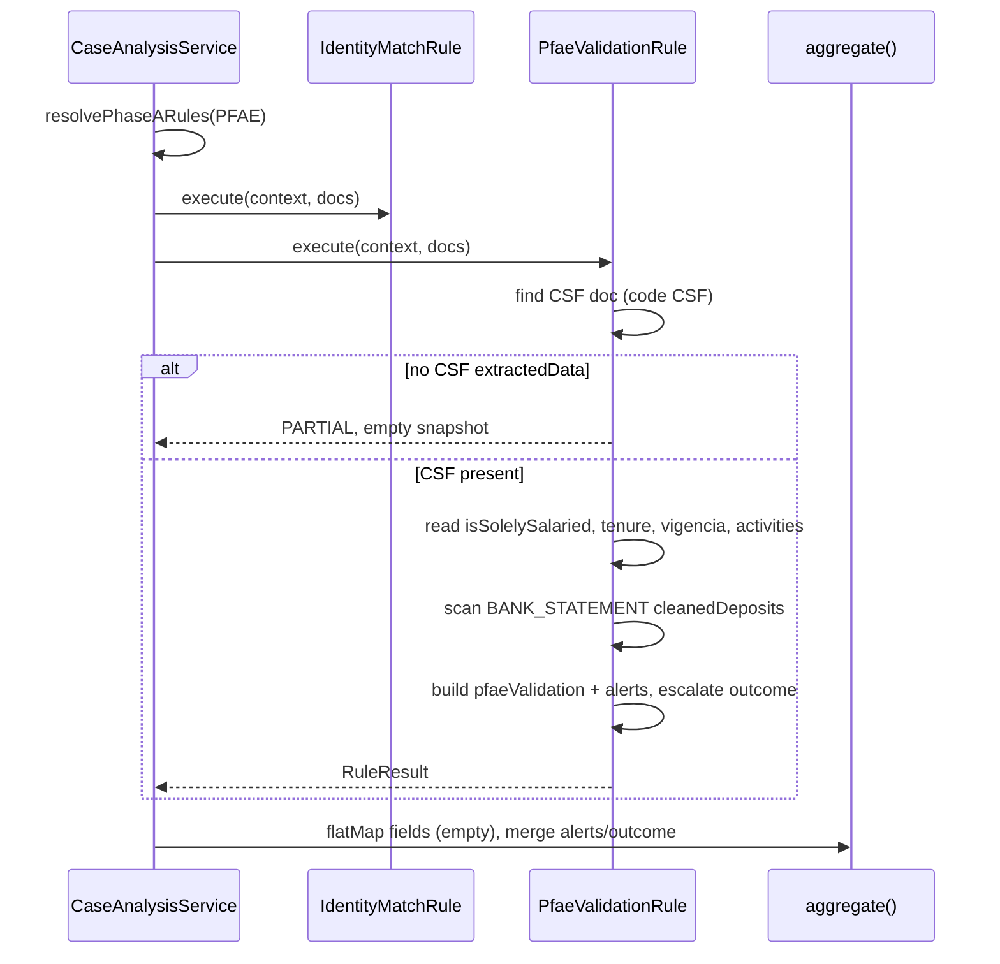

# Design: PFAE Validation Gates (HU-19b)

## Technical Approach

Add `PfaeValidationRule` (`ruleId: pfae-validation`) as a deterministic Phase A rule for PFAE cases. It re-derives PLAN-FASE gates from persisted CSF and bank-statement extraction fields — not from document `alerts[]`. Register alongside `IdentityMatchRule` in `resolvePhaseARules`; SALARIED keeps `[identity, bankarization]`. Payload mirrors bankarization: `detail.fields: []`, typed snapshot on `detail.pfaeValidation`, gate signals in `alerts[]`. Orchestrator `aggregate()` unchanged; empty `fields` avoids identity-table pollution.

## Architecture Decisions

| Decision | Alternatives | Choice & Rationale |
|----------|--------------|-------------------|
| Rule implementation | (1) Copy CSF alerts | **(2) Dedicated rule** — avoids `ARRAIGO_INSUFICIENTE` and tax-loss noise; stable HU-21 contract |
| Registration | Rule self-skips SALARIED | **Orchestrator-only** — PFAE `[identity, pfaeValidation]`; defensive PASS if mis-invoked |
| Payload shape | Flatten into `fields` | **`pfaeValidation` + empty `fields`** — matches bankarization; identity UI counters stay correct |
| Coherence source | New classifier | **Scan `cleanedDeposits[].trashCategory`** — HU-17 already tags `RENT_WITHOUT_CSF_REGIME` |
| Activity gate | `ACTIVITY_UNMAPPED` | **Persist SAT text only** — no catalog until HU-20 |
| Types location | Inline only | **`types/pfae-validation.types.ts`** — shared contract for rule, tests, future HU-21 |

## Data Flow



**Outcome escalation (rule-internal):** FAIL (solely salaried) > PARTIAL (missing CSF, vigencia WARNING, coherence WARNING) > PASS. Tenure emits INFO alert only — no outcome escalation. Phase A FAIL does not block B/C; aggregate still runs comparativa.

## File Changes

| File | Action | Description |
|------|--------|-------------|
| `apps/api/src/case-analysis/types/pfae-validation.types.ts` | Create | `PfaeValidationSnapshot`, gate outcome literals |
| `apps/api/src/case-analysis/rules/pfae-validation.rule.ts` | Create | Gate logic, alert emission, `execute()` |
| `apps/api/src/case-analysis/rules/pfae-validation.rule.spec.ts` | Create | Unit tests; copy `doc()` helper from identity spec |
| `apps/api/src/case-analysis/case-analysis.service.ts` | Modify | Inject rule; PFAE → `[identity, pfaeValidation]` |
| `apps/api/src/case-analysis/case-analysis.module.ts` | Modify | Register `PfaeValidationRule` provider |
| `apps/api/src/case-analysis/case-analysis.service.spec.ts` | Modify | PFAE calls pfae-validation, not bankarization |
| `openspec/changes/.../specs/` | Modify | Delta specs (parallel sdd-spec) |

No changes: `analysis-rule.interface.ts` (`RuleDetail` index signature suffices), CSF/bank extraction, `analysis-section.tsx` (Validaciones hardcoded; unknown `ruleId`s do not auto-render).

## Interfaces / Contracts

```typescript
export type PfaeGateOutcome = 'PASS' | 'PARTIAL' | 'FAIL' | 'WARNING' | 'INFO';

export interface PfaeValidationSnapshot {
  regime: { isSolelySalaried: boolean; outcome: 'PASS' | 'FAIL' };
  vigencia: {
    issuanceDate: string | null;
    isOlderThan3Months: boolean;
    outcome: 'PASS' | 'WARNING';
  } | null;
  tenure: {
    months: number | null;
    activityStartDate: string | null;
  } | null;
  activity: { satDescription: string | null; percentage: number | null } | null;
  coherence: { rentWithoutRegimeCount: number; outcome: 'PASS' | 'WARNING' } | null;
}

// RuleResult.detail shape (fields always []):
// { sources: ['csf', 'bank-statement'?], fields: [], pfaeValidation: PfaeValidationSnapshot }
```

**Field reads:** CSF `extractedData` — `isSolelySalaried`, `tenureMonths`, `activityStartDate`, `issuance.isOlderThan3Months`, `issuance.issuanceDate`, `activities[]` (highest active `percentage` for `satDescription`). Bank — sum `financialDepuration.cleanedDeposits` where `trashCategory === 'RENT_WITHOUT_CSF_REGIME'` across `BANK_STATEMENT` docs; omit `coherence` when no statements or no depuration array.

**Alert codes (`RuleAlert`):**

| Gate | ruleCode | severity |
|------|----------|----------|
| Solely salaried | `REGIMEN_EXCLUSIVAMENTE_ASALARIADO` | ERROR |
| Missing CSF | `PFAE_CSF_MISSING` | WARNING |
| Vigencia | `VIGENCIA_MAYOR_3_MESES` | WARNING |
| Tenure | `PFAE_ACTIVITY_TENURE` | INFO |
| Coherence | `RENT_WITHOUT_CSF_REGIME` | WARNING |

Ignore CSF document `alerts[]`, `ARRAIGO_INSUFICIENTE`, and tax-return alerts.

## Testing Strategy

| Layer | What | Approach |
|-------|------|----------|
| Unit | All gate paths | `pfae-validation.rule.spec.ts`: solely salaried FAIL; no CSF PARTIAL; vigencia WARNING; tenure 12mo INFO not FAIL; coherence WARNING; SALARIED context PASS; tax-loss ignored |
| Integration | Orchestrator wiring | Extend `personType-aware phaseARules` describe: mock `PfaeValidationRule`; PFAE invokes it + not bankarization; SALARIED regression unchanged |

## Migration / Rollout

No migration. Remove provider + PFAE registration to rollback. Existing `AnalysisRun` rows unaffected.

## Open Questions

None.
