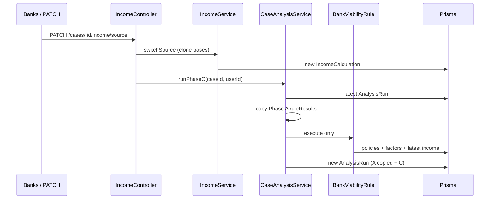

# Design: PFAE HU-20 Bank Comparison

## Technical Approach

Approach 1: per-bank `BankActivityFactor`, `personType` Phase C branch, Banks UI, Phase-C-only re-run. Cálculo unfactored (`average*` = chosen base). Comparativa multiplies after source. NestJS Controller → Service → Prisma. Do not edit `bank-comparison-tab.tsx`.

## Architecture Decisions

| Decision | Options | Tradeoff | Choice |
|----------|---------|----------|--------|
| Giro catalog | Global `ActivityType` vs per-bank rows | Workshop vs heterogeneous labels | `BankActivityFactor` on `Bank` |
| Santander $67k | New destination vs existing row | Extra enum vs reuse | `minimumIncomePfae=67000` on active `SANTANDER_CNS` (`CONSTRUCCION`) |
| Optional CMA | Bank-code ifs vs nullable cells | Hardcoded vs catalog | `personType==='PFAE' && cell!=null ? cell : salaried` |
| `CONDITIONED` | New status vs existing union | UI already badges it | `resolveProductStatus` returns it for `TAX_RETURN`+`NOT_PREFERRED` |
| Phase-C re-run | Mutate run / full `run()` / copy A | Immutability; Validaciones blank | `runPhaseC`: copy prior `detail.ruleResults` except `bank-viability` |
| PATCH home | `/mortgage-cases/...` vs income controller | Two paths | `PATCH /cases/:caseId/income/source` only |
| Factor > 1 | Reuse `debtCommitmentFactor` vs new DTO | `@Max(1)` | Separate factor DTO, `@Min(0)` no max |
| BX+ dual factor | One column vs two | Extra column | `factor` + `factorTaxReturn`; equal except seeded BX+ diffs |
| ACTIVITY_UNMAPPED | Two matchers vs one helper | Drift | One matcher. Phase A WARNING if any MATRIX bank misses; Phase C that bank `REQUIRES_REVIEW`; never 1.0. FLAT/NONE skip |
| Circular DI | Service inject vs controller | Cycle (analysis already imports income) | Income controller calls `runPhaseC`; both modules `forwardRef` |

## Data Flow



Full `run()` unchanged: Phase A (`identity-match` + `pfae-validation` for PFAE) → B → C. `detail` = `{ ruleResults, sources, fields, bankViability }`. Copying Phase A keeps HU-21 Validaciones populated.

**Phase C PFAE:** `personType` → `source`/`bases` → tax policy → giro after base → CSF `activityStartDate` vs `minimumActivityTenureMonths` → nullable PFAE CMA cells → existing knockouts/CE/pagadora. SALARIED: hire-date tenure, unfactored CE.

## File Changes

| File | Action | Description |
|------|--------|-------------|
| `apps/api/prisma/schema.prisma` | Modify | Enums `PfaeFactorMode`, `TaxReturnPolicy`. `Bank`: `pfaeFactorMode`, `pfaeFlatFactor?`, `taxReturnPolicy`. `BankPolicy`: `minimumActivityTenureMonths?`, `minimumIncomePfae?`, `minimumApplicantAgeMonthsPfae?`. Model `BankActivityFactor` (`nativeLabel`, `satAliases Json`, `factor`, `factorTaxReturn?`) |
| `apps/api/prisma/seed-data.ts` + spec | Modify | Banorte FLAT 0.6 + NOT_PREFERRED; HSBC NONE; Scotiabank REJECTED; Banamex age PFAE 336m; Santander PFAE 15k / CNS 67k; HSBC_LIQ inactive; Mifel 0.50; captura-first factors; BX+ dual diffs |
| `apps/api/src/case-analysis/activity-factor-match.ts` + spec | Create | Shared normalize+alias match; FLAT/NONE skip |
| `apps/api/src/case-analysis/rules/pfae-validation.rule.ts` + spec | Modify | Inject Prisma; if any MATRIX bank misses CSF alias → PARTIAL WARNING `ACTIVITY_UNMAPPED` |
| `apps/api/src/case-analysis/rules/bank-viability.rule.ts` + types + spec | Modify | Load `personType`, `source`, `bases`; PFAE branch; CMA pick; tenure; `resolveProductStatus` CONDITIONED; unmapped `REQUIRES_REVIEW` |
| `apps/api/src/case-analysis/case-analysis.service.ts` + spec | Modify | `runPhaseC`; copy Phase A `ruleResults`; BankViability only; same persist/aggregate |
| `apps/api/src/income-calculation/*` | Modify | Expand `TWELVE_MONTH_KEYWORDS`; NFD-strip accents; keep `bases.activity.*`. `switchSource`; 400 invalid/tax-loss/SALARIED. Controller PATCH + `runPhaseC` |
| `apps/api/src/banks/*` | Modify | PATCH card fields; policy PFAE cells; CRUD `/banks/:code/activity-factors` |
| `apps/web/app/ui/banks/*`, `definitions.ts`, `actions/banks.ts` | Modify | Factor card, factors table (`>1`), PFAE CMA columns. Not expediente |
| `apps/web/app/ui/expedientes/bank-comparison-tab.tsx` | Unchanged | HU-21 |

## Interfaces / Contracts

```
PATCH /cases/:caseId/income/source
{ "source": "BANK_STATEMENTS" | "TAX_RETURN" }
```

`ingresoAdmisible = chosenBase × factor` (TAX_RETURN uses `factorTaxReturn` if set). NONE → 1.0. FLAT → `pfaeFlatFactor`. MATRIX miss → no 1.0.

`resolveProductStatus` order: NOT_COMPATIBLE (incl. `TAX_RETURN`+REJECTED) → REQUIRES_REVIEW (incl. `ACTIVITY_UNMAPPED`, missing CSF date + set tenure) → CONDITIONED (`TAX_RETURN`+NOT_PREFERRED) → PRELIMINARY_VIABLE.

Keyword normalize (non-obvious): NFD + strip marks so `ganadería` matches `ganaderia`. Add `cultivo`, `ganaderia`, `pecuario`, `pesca`, `agricola`, `restaurante`; keep `primaria` / `restaurantero` / `alimentos y bebidas`.

## Testing Strategy

| Layer | What to Test | Approach |
|-------|-------------|----------|
| Unit | Matcher FLAT/NONE/MATRIX; keywords; CMA pick; `resolveProductStatus` CONDITIONED; `switchSource` 400 tax-loss; DTO factor 1.5; seed locks | Jest next to files |
| Integration | `runPhaseC` copies Phase A; PATCH then new AnalysisRun; Banks CRUD | Existing Nest testing modules |
| E2E | Banks UI manual/QA; no expediente Comparativa | Out of this HU |

SALARIED `bank-viability.rule.spec` payroll fixtures stay green.

## Migration / Rollout

Additive Prisma migration + re-seed. Nullable PFAE cells. No flag. Revert branch + roll back migration. Snapshots/runs append-only.

## Open Questions

None. Spec risks 1–9 closed above.
